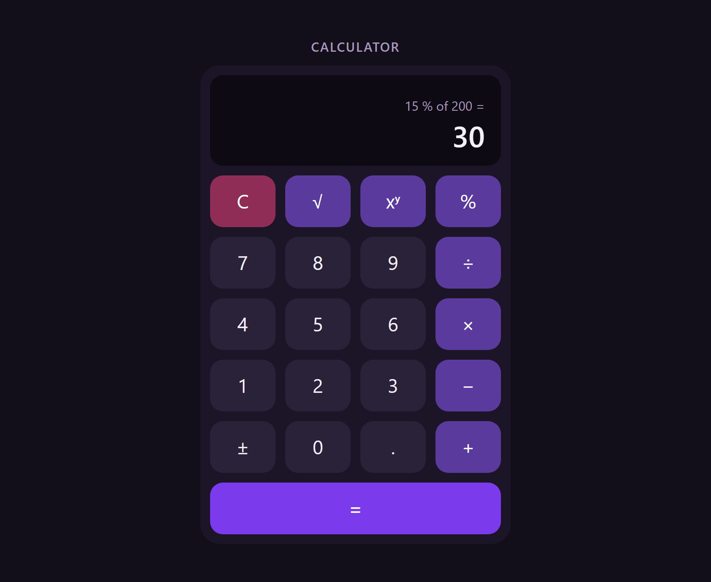
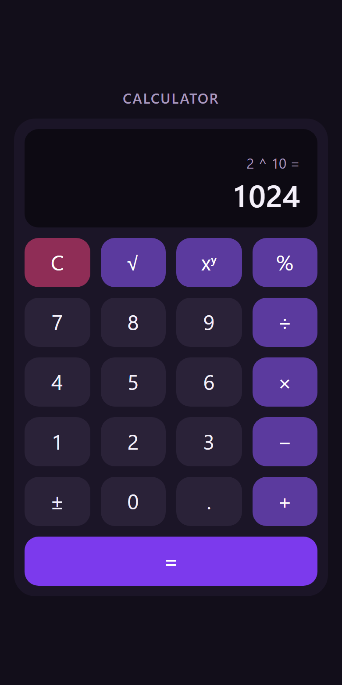

# Go + React Calculator

A calculator with a React + TypeScript keypad that sends every calculation to a Go REST API. The
backend does all the math; the frontend handles keypad input and displays results and errors.

<p align="center">
  
  &nbsp;&nbsp;
  
</p>

- **Operations:** add, subtract, multiply, divide, power, square root, and percentage (`a % of b`).
- **Backend:** Go standard library only, one JSON endpoint with strict validation.
- **Frontend:** React 19, TypeScript and Vite; a pure reducer drives the keypad.
- **Tests:** 95 Go test cases and 63 frontend tests, with 100% statement coverage of the
  calculator and API packages.

## Requirements

| Tool | Version | Notes |
|---|---|---|
| Go | 1.27+ | Go 1.21 or newer downloads the required toolchain automatically |
| Node.js | 22.12+ or 24+ | Minimum for Vite 8 and Vitest 5 |
| npm | 10+ | Ships with Node.js |

## Quick start

Run the API and the UI in two terminals:

```bash
# Terminal 1: API on http://127.0.0.1:8081
cd backend
go run ./cmd/server

# Terminal 2: UI on http://localhost:5173
cd frontend
npm ci
npm run dev
```

Open <http://localhost:5173>. Vite forwards `/api` requests to the Go server, so the browser
talks to one origin and no CORS setup is needed. Stop either server with Ctrl+C; the API shuts
down gracefully.

The API listens on `127.0.0.1:8081` by default. Set `ADDR` to change it (for example
`ADDR=127.0.0.1:9090`), and update the proxy target in
[`frontend/vite.config.ts`](frontend/vite.config.ts) to match.

## Tests and coverage

| | Backend (run in `backend/`) | Frontend (run in `frontend/`) |
|---|---|---|
| Tests | `go test ./...` | `npm test` |
| Static checks | `go vet ./...` and `gofmt -l .` (prints nothing when formatted) | `npm run lint` (Oxlint) and `npm run build` (type-check and build) |
| Coverage | `go test ./... -coverprofile=coverage.out`, then `go tool cover -html=coverage.out` | `npm run coverage` (HTML report in `frontend/coverage/`) |

Coverage summary:

| Layer | Area | Tests | Statement coverage |
|---|---|---|---|
| Backend | `internal/calculator` | 62 | 100% |
| Backend | `internal/api` | 33 | 100% |
| Backend | `cmd/server` | none | 0%: wiring only, checked by running the server (module total 72.9%) |
| Frontend | `src/` | 63 | 99.15%, with 100% of branches and functions; only the `main.tsx` bootstrap line is uncovered |

## API reference

### `POST /api/v1/calculate`

| Field | Type | Notes |
|---|---|---|
| `operation` | string | One of the operations below; lowercase |
| `a` | number | Always required |
| `b` | number | Required for every operation except `sqrt`, which must not send it |

| `operation` | Computes | Example body | `result` |
|---|---|---|---|
| `add` | a + b | `{"operation":"add","a":2,"b":3}` | `5` |
| `subtract` | a − b | `{"operation":"subtract","a":2,"b":3}` | `-1` |
| `multiply` | a × b | `{"operation":"multiply","a":4,"b":2.5}` | `10` |
| `divide` | a ÷ b | `{"operation":"divide","a":10,"b":4}` | `2.5` |
| `power` | a ^ b | `{"operation":"power","a":2,"b":10}` | `1024` |
| `sqrt` | √a | `{"operation":"sqrt","a":9}` | `3` |
| `percentage` | a % of b = a × b / 100 | `{"operation":"percentage","a":15,"b":200}` | `30` |

Every response is JSON. Success is `200` with `{"result": <number>}`; errors are
`{"error": "<message>"}`:

| Status | When | Example `error` |
|---|---|---|
| 400 | Invalid input: empty or malformed JSON, data after the object, unknown field, wrong type, number outside the float64 range, missing or unknown `operation`, missing `a` or `b`, `b` sent with `sqrt` | `"a" must be a number` |
| 400 | Math errors (table below) | `cannot divide by zero` |
| 404 | Unknown path under `/api/` | `not found` |
| 405 | Method other than `POST`; the response has `Allow: POST` | `method not allowed` |
| 413 | Body larger than 1 KiB | `request body must not be larger than 1024 bytes` |
| 500 | Unexpected error; details only go to the server log | `internal server error` |

| Math error | `error` |
|---|---|
| Division by zero | `cannot divide by zero` |
| Zero to a negative power | `cannot raise zero to a negative power` |
| Negative base with a fractional exponent | `cannot raise a negative number to a fractional power` |
| Square root of a negative number | `cannot take the square root of a negative number` |
| Result beyond ±1.8e308 | `result is out of range` |

Math errors use 400 rather than 422 to keep one simple rule for clients; the message tells the
cases apart.

### Examples

curl (bash on macOS or Linux, or Git Bash on Windows):

```bash
curl -s -X POST http://localhost:8081/api/v1/calculate \
  -H 'Content-Type: application/json' \
  -d '{"operation":"percentage","a":15,"b":200}'
# {"result":30}

curl -s -i -X POST http://localhost:8081/api/v1/calculate \
  -H 'Content-Type: application/json' \
  -d '{"operation":"divide","a":1,"b":0}'
# HTTP/1.1 400 Bad Request
# Content-Type: application/json
# ...
# {"error":"cannot divide by zero"}
```

PowerShell:

```powershell
Invoke-RestMethod -Method Post -Uri http://localhost:8081/api/v1/calculate `
  -ContentType 'application/json' -Body '{"operation":"percentage","a":15,"b":200}'
# result
# ------
#     30

# Windows PowerShell throws on 4xx and 5xx; the JSON error body is in ErrorDetails
try {
  Invoke-RestMethod -Method Post -Uri http://localhost:8081/api/v1/calculate `
    -ContentType 'application/json' -Body '{"operation":"divide","a":1,"b":0}'
} catch { $_.ErrorDetails.Message }
# {"error":"cannot divide by zero"}
```

> **Windows PowerShell 5.1 and `curl.exe`:** avoid piping JSON into `curl.exe`
> (`'{...}' | curl.exe --data-binary '@-' ...`). PowerShell adds a UTF-8 byte-order mark
> (`EF BB BF`) to text piped into native programs, and the API rejects the body as invalid JSON;
> RFC 8259 forbids a byte-order mark in JSON sent over a network. Use `Invoke-RestMethod`, or curl
> from Git Bash or WSL.

## Design decisions

| Decision | Why | Trade-off |
|---|---|---|
| One endpoint, `POST /api/v1/calculate`, with the operation in the body | One handler and one validation path. Adding an operation is a calculator function plus a table entry. Fits the keypad, where `=` sends whichever operator was pressed. | The request shape varies by operation (`sqrt` has no `b`), and the operation is not visible in URLs or access logs |
| Go standard library only | No third-party modules to vet or update (no `go.sum`). Go 1.22 `ServeMux` routes by method, and `log/slog` handles logging. | Some hand-written plumbing: strict JSON decoding and JSON responses for 404 and 405 |
| A pure `calculator` package with sentinel errors | The arithmetic knows nothing about HTTP or JSON and is tested on its own. Only the `api` package maps errors to status codes, using `errors.Is`. | Each new sentinel error must be added to that mapping, or it becomes a 500 |
| Strict JSON decoding | Operands are `*float64`, so a missing field is not confused with `0`. Unknown fields, wrong types, extra data and bodies over 1 KiB are rejected with a clear message. | No leniency: `"5"` is not coerced to a number. Unknown fields are detected from the text of an `encoding/json` error, which has no error type for them. |
| The keypad is a pure reducer with phases: `first`, `operator`, `second`, `pending`, `error` | Each phase holds only the data valid in it, so impossible states cannot be represented. The reducer runs without React (29 tests), and selectors derive both display lines. | More types up front than a few `useState` calls |
| The backend does all the math | One source of truth. The frontend only edits the typed text and formats results for display. | Every `=` and `√` is a network round trip |
| Request cancellation | The `useCalculator` hook sends the pending request with an `AbortController`. Pressing C or unmounting aborts it, and late answers are ignored. | A little more code than an uncancelled call |
| Plain CSS with WCAG AA contrast | One stylesheet with the palette as CSS custom properties. Every text color is at least 4.5:1 on its background, including hover and pressed states (the tightest is 4.78:1), and the focus ring is at least 3:1. | Class names are global, so they follow a naming convention instead of being scoped |
| Port 8081 on loopback | Port 8080 was taken by another service on the development machine. Binding `127.0.0.1` avoids a Windows Firewall prompt on every `go run`. | Not the usual 8080; `ADDR` overrides it |

## Assumptions

1. **Numbers are IEEE 754 doubles end to end** (Go `float64`, JavaScript `number`), with about 15
   to 17 significant digits and binary rounding: the API returns `0.30000000000000004` for
   `0.1 + 0.2`, and the UI shows `0.3` because it rounds to 15 significant digits for display
   only. Inputs are always finite, because JSON cannot encode NaN or Infinity, so the calculator
   package does not check for them.
2. **Percentage** means `a % of b = a × b / 100` (15 % of 200 = 30); `a` may be negative or
   above 100.
3. **Power:** `0^0 = 1`, zero to a negative power is an error, and a negative base needs an
   integer exponent (no complex numbers).
4. **Square root** accepts real numbers only and takes one operand, `a`. The keypad applies it
   immediately to the number shown.
5. **Overflow** beyond ±1.8e308 is an error. Underflow becomes `0`, and `-0` is reported as `0`.
6. **One operation at a time:** no operator precedence or chaining. After a result, type a new
   number or press an operator to continue from it. Negative numbers are entered with ±; there is
   no backspace, so C clears.
7. Operation names are lowercase and case-sensitive, and operands must be JSON numbers.
8. There is no authentication, rate limiting, persistence or history.

## Known limitations

- JSON field names match case-insensitively, which is standard `encoding/json` behavior, so
  `{"OPERATION":"add", ...}` is accepted.
- Numbers too small for a float64, such as `1e-400`, silently become `0`.
- Typed numbers are limited to 15 digits. Results are rounded to 15 significant digits for display,
  though the exact value is kept for the next calculation, and very large or small results use
  exponent notation, such as `1.52415787532387e+28`.
- No keyboard shortcuts: digits can't be typed on a physical keyboard, although every key can be
  reached with Tab and pressed with Enter or Space.
- No request logging, metrics or health-check endpoint.

## How I used AI

| Who | Role |
|---|---|
| Claude Code (VS Code extension) | Implemented each step from a plan I approved, ran the tests and checks, and explained its decisions and the Go and React idioms as it went |
| A separate Claude chat | Drafted the initial plan and [`CLAUDE.md`](CLAUDE.md), the conventions Claude Code follows. Then acted as a reviewer: discussing Claude Code's plans and output, and helping me word prompts. |
| Me | Reviewed every change, ran the app and the tests, and committed each step myself, one commit per step |

Every prompt is in [PROMPTS.md](PROMPTS.md), verbatim except for the recruiter's greeting and
logistics, which are omitted for privacy.

## Project structure

```
backend/
  cmd/server/            entrypoint: ADDR config, logging, timeouts, graceful shutdown
  internal/calculator/   pure arithmetic and sentinel errors
  internal/api/          HTTP handler, strict JSON decoding, error-to-status mapping
frontend/
  src/api/               typed API client, the only code that calls fetch
  src/state/             keypad reducer, display selectors, useCalculator hook
  src/components/        Calculator, Display, Keypad
  src/utils/             number formatting for the display
  src/index.css          theme and responsive layout
docs/                    README screenshots
CLAUDE.md                conventions for Claude Code
PROMPTS.md               prompts used during development
```
